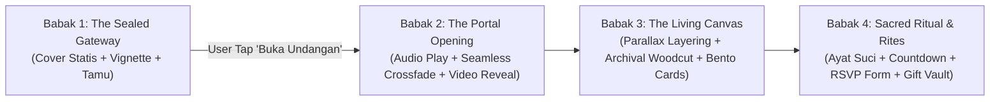
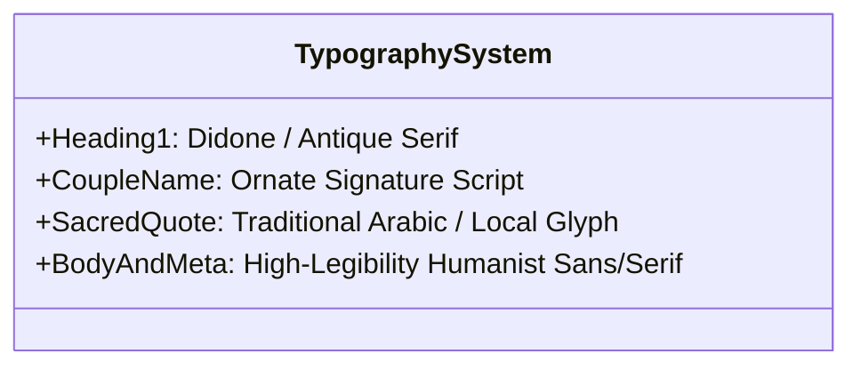
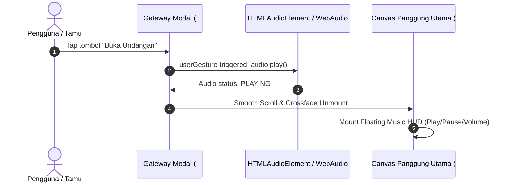

# MOTION ART (ARTMOTION) TECHNICAL STANDARD SPECIFICATION
**Dokumen Spesifikasi Master Desain & Engineering Motion Art**
*Penyusun: Tim Sikobokan (Orchestrator: Anggarenn | Lead Author: Ungger — Senior Technical Writer)*
*Target Platform: Next.js 15+ (App Router), React 19, Tailwind CSS v4, Framer Motion / GSAP ScrollTrigger*
*Benchmark Acuan: Folk Invitation (`folkinvitation.id/motion-art-aceh-black`)*
*Status Dokumen: OFFICIAL STANDARD SPEC — TIER-1 PRODUCTION BASELINE*

---

## 1. Arsitektur & Filosofi Motion Art

### 1.1 Definisi & Inti Estetika (The Living Archival Painting)
Motion Art (Artmotion) adalah paradigma antarmuka web undangan pernikahan digital dan landing page bercerita (storytelling narrative) yang menggabungkan:
1. **Archival Engraving & Lithography Abad ke-19**: Detail arsir intaglio, woodcut etching halus gaya Albrecht Dürer, goresan cukil kayu, dan tekstur plat tembaga.
2. **Cultural Elegance & Etnik Tradisional Nusantara**: Ornamen lokal (misalnya Motif Pinto Aceh, Bungong Jeumpa, Pucuk Rebung, Sulur Megamendung, Ukiran Jepara, Songket Minang) yang distilisasi ke dalam garis ornamen presisi tinggi.
3. **Cinematic Dark Gothic / Noir Velvet**: Palet dasar hitam obsidian pekat (`#0A0A0A` / `#121212`) yang dikontraskan dengan sapuan kilau emas kusam (*antique foil gold* / *champagne bronze*) dan aksen parchment ivory.
4. **Cinematic Micro-Motion**: Alih-alih transisi web biasa yang kaku, elemen visual bergerak seperti *slow-motion cinematic living canvas* (putaran 0.5x kecepatan, kabut mengambang, loop berkesinambungan 8–15 detik, partikel emas halus, dan depth-of-field 2.5D).

### 1.2 Narrative Emotional Journey
User experience Motion Art dirancang dalam 4 babak teatrikal:


---

## 2. Anatomy Panggung & Layering Stack (The 5-Layer Proscenium)

Tampilan panggung Motion Art mengadopsi prinsip kedalaman visual teater (*Proscenium Theater Stacking*). Setiap lapisan viewport memiliki hierarki `z-index`, efek blend-mode, dan siklus render tersendiri:

```
[ Viewport Depan / Interaksi ]
  ▲
  │  Layer 4: Persistent Audio Pill, Navigation HUD, Floating Action (z-index: 50)
  │  Layer 3: Hero Bento Cards, Typography, Countdown, Form RSVP (z-index: 30)
  │  Layer 2: Ambient Mist, Radial Vignette, Light Leaks Overlay (z-index: 20)
  │  Layer 1: Lace Header & Archival Filigree Frames (z-index: 10)
  │  Layer 0: Background Canvas (Seamless Looping Video / Animated WebP) (z-index: 0)
  ▼
[ Kanvas Dasar / DOM Root ]
```

### 2.1 Rincian Setiap Lapisan (Layer Specification)

| Layer | Komponen | Format / Elemen | Perilaku & CSS Transform |
| :--- | :--- | :--- | :--- |
| **Layer 0** | **Base Backdrop Video** | `<video>` H.264 MP4 / WebM VP9 (Loop) | `position: fixed` / `absolute inset-0`, `object-fit: cover`, `opacity: 0.85`, filter grayscale 20% + contrast 115%. |
| **Layer 1** | **Lace & Filigree Frame** | WebP Transparan (Alpha Channel) | `pointer-events: none`, menempel di top/bottom border (`translate-y-0`), ornamen renda berulang dengan efek bayangan jatuh halus (`drop-shadow(0 10px 15px rgba(0,0,0,0.8))`). |
| **Layer 2** | **Ambient Mist & Vignette** | CSS Gradient + Canvas 2D Particles | `radial-gradient(circle, transparent 40%, #0A0A0A 95%)`, efek kabut tipis (*flickering smoke*) dengan CSS `@keyframes drift` durasi 20–30s linear infinite. |
| **Layer 3** | **Floating Bento Content** | Semantic HTML (`<main>`, `<article>`, `<section>`) | Kartu bento hitam matte (`bg-stone-950/80 backdrop-blur-md`), border foil hairline `border-amber-600/20`, animasi entry `zoomIn` / `translateY` via ScrollTrigger / Intersection Observer. |
| **Layer 4** | **Audio HUD & Floating Controls** | Fixed Interactive Components | Fixed bottom right/center (`z-50`), tombol music toggle berputar saat active (`animate-spin-slow`), pulse ring emas saat dimainkan. |

---

## 3. Design System & Typography Rules

### 3.1 Color Palette (Aceh Black & Antique Gold Baseline)

```
Primary Background : #0A0A0A (Obsidian Black)
Card Matte         : #141414 (Smoked Charcoal 85% opacity)
Surface Border     : rgba(212, 175, 55, 0.22) (Hairline Gold Foil)
Accent Gold Glow   : #D4AF37 (Metallic Antique Gold)
Accent Gold Bright : #F3E5AB (Champagne Gilding Highlight)
Accent Bronze/Muted: #8C733E (Aged Deep Bronze)
Text Main Header   : #F7F4EB (Parchment White / Warm Ivory)
Text Body / Sub    : #C4BEB1 (Weathered Muted Cream)
Danger / Attending : #2D7A4D (Emerald Green) | #A8282B (Deep Venetian Ruby)
```

### 3.2 Typography Hierarchy Matrix

Karakter Motion Art dibangun atas perpaduan 4 keluarga font (Serif Klasik, Script Signature, Aksara Sakral, dan Sans Minimalis):



1. **Display & Section Titles (Antique / Didone Serif)**
   - *Font Stack*: `Cinzel Decorative`, `Playfair Display`, `New York`, `Bodebeck`, `EB Garamond`.
   - *Karakteristik*: High contrast stroke, delicate bracketed serifs, uppercase dengan wide tracking (`letter-spacing: 0.15em - 0.25em`).
   - *Ukuran*: Desktop `36px - 48px`, Mobile `28px - 34px`.

2. **Couple Names & Accent Monograms (Gold Foil Script)**
   - *Font Stack*: `Pinyon Script`, `Aston Script`, `The Signature`, `Parisienne`, `Shelley Allegro`.
   - *Karakteristik*: Goresan kuas/pena kaligrafi elegan, kemiringan ekspresif, diberi efek kilau gradien emas CSS text-fill:
     ```css
     background: linear-gradient(135deg, #F3E5AB 0%, #D4AF37 50%, #AA771C 100%);
     -webkit-background-clip: text;
     -webkit-text-fill-color: transparent;
     ```
   - *Ukuran*: Desktop `54px - 72px`, Mobile `42px - 56px`.

3. **Sacred Scripts & Cultural Glyphs (Aksara Sakral)**
   - *Font Stack*: `Amiri Bold` / `Amiri Quran` (Arab Melayu / Ayat Al-Qur'an), `Noto Serif Jawi`, atau Custom Vector SVG Glyphs untuk aksara tradisional daerah.
   - *Karakteristik*: Harakat seimbang, line-height lega (`leading-loose` / `2.4em`), centered alignment dengan ornamen divider di atas dan bawah.

4. **Body Copy, Detail Acara & Navigasi (Humanist Neutral)**
   - *Font Stack*: `Cinzel`, `Cormorant Garamond` (untuk gaya klasik) atau `Plus Jakarta Sans`, `Inter` (300/400 weight untuk kejelasan angka tanggal & jam).
   - *Karakteristik*: High-legibility, warna `#D6D0C4`, line-height `1.7em`.

---

## 4. Engineering Standards (Next.js & Browser Runtime)

### 4.1 Next.js Video Background Handling & Autoplay Compliance

Browser modern (khususnya iOS WebKit dan Google Chrome) memblokir autoplay media ber-audio dan memberikan batasan ketat pada background video. Implementasi wajib mematuhi standar berikut:

#### Komponen Video Canvas Standar (`MotionBackdrop.tsx`)
```tsx
import React, { useRef, useEffect } from 'react';

interface MotionBackdropProps {
  videoSrcMp4: string;
  videoSrcWebm?: string;
  posterSrc: string;
}

export const MotionBackdrop: React.FC<MotionBackdropProps> = ({
  videoSrcMp4,
  videoSrcWebm,
  posterSrc,
}) => {
  const videoRef = useRef<HTMLVideoElement>(null);

  useEffect(() => {
    const video = videoRef.current;
    if (!video) return;

    // Pastikan video di-mute di level DOM property sebelum play
    video.muted = true;
    video.defaultMuted = true;

    const playPromise = video.play();
    if (playPromise !== undefined) {
      playPromise.catch((error) => {
        console.warn("[MotionArt Engine] Video autoplay was prevented:", error);
      });
    }
  }, []);

  return (
    <div className="fixed inset-0 w-full h-full overflow-hidden -z-10 pointer-events-none select-none">
      <video
        ref={videoRef}
        autoPlay
        loop
        muted
        playsInline
        preload="auto"
        poster={posterSrc}
        className="w-full h-full object-cover object-center filter brightness-[0.82] contrast-[1.12]"
        aria-hidden="true"
        tabIndex={-1}
      >
        {videoSrcWebm && <source src={videoSrcWebm} type="video/webm" />}
        <source src={videoSrcMp4} type="video/mp4" />
      </video>
      {/* Ambient Vignette & Mist Layer */}
      <div 
        className="absolute inset-0 bg-radial-vignette opacity-80 mix-blend-multiply"
        style={{
          background: 'radial-gradient(circle at center, transparent 35%, rgba(10,10,10,0.85) 85%, #0A0A0A 100%)'
        }}
      />
    </div>
  );
};
```

### 4.2 Web Audio API & Two-Phase Invitation Unlock Architecture

Sesuai pola benchmark Folk Invitation (`#tombolBuka` -> `#bukaUndangan`), audio hanya boleh diputar setelah ada interaksi eksplisit pengguna:



1. **Gate Unlocking Flow**:
   - `body` terkunci pada posisi cover (`overflow: hidden`).
   - Saat tombol "Buka Undangan" diklik:
     - `audio.play()` dieksekusi secara instan di dalam listener gesture.
     - Kunci overflow dilepas (`document.body.style.overflow = "auto"`).
     - Halaman melakukan scroll halus ke anchor `#bukaUndangan` (durasi 700ms, easing `cubic-bezier(0.16, 1, 0.3, 1)`).
     - Elemen persistent music pill muncul dengan transisi `translate-y-0 opacity-100`.

### 4.3 60 FPS Performance & Memory Budget

Untuk menjamin kelancaran 60 FPS pada perangkat mobile kelas menengah (Android snapdragon seri 6 / iOS lama):

1. **Composite-Only Animations**:
   - Hanya gunakan properti yang dihitung GPU: `transform` (3D: `translate3d`, `scale3d`, `rotate3d`) dan `opacity`.
   - **DILARANG** menginterpolasi properti yang memicu Layout/Reflow: `top`, `left`, `width`, `height`, `margin`, `padding`, `filter: blur()` secara berulang di event scroll.
   - Gunakan `will-change: transform` hanya pada elemen yang aktif beranimasi, dan hapus saat elemen diam untuk menghindari *GPU memory bloat*.

2. **Scroll Execution Standard**:
   - Gunakan `requestAnimationFrame` (rAF) throttle atau library performa tinggi seperti `Lenis` atau GSAP `ScrollTrigger`.
   - Hindari pemanggilan `getBoundingClientRect()` di dalam loop scroll.

3. **Target Budget Metrik (Performance Budget)**:
   - **Video Loop Size**: Maksimum **2.5 MB** (MP4) / **1.8 MB** (WebM).
   - **Single Ornamen WebP**: Maksimum **80 KB** per file aset.
   - **Total First View Payload**: Maksimum **4.0 MB** (termasuk video, audio buffer awal, dan font).
   - **Runtime Memory Heap**: Stabil di bawah **85 MB** (tidak ada audio context leak atau unclosed canvas context).
   - **Largest Contentful Paint (LCP)**: `< 2.2 detik` pada koneksi 4G.
   - **Cumulative Layout Shift (CLS)**: `< 0.02` (seluruh container media memiliki `aspect-ratio` eksplisit).

---

## 5. Asset Generation Pipeline (Woodcut, Lithograph & Video)

Kualitas Motion Art sangat bergantung pada konsistensi visual aset seni ukir (*engraving*). Berikut adalah alur pembuatan aset dari AI image generation hingga optimasi produksi:

### 5.1 Woodcut / Lithograph AI Prompt Engineering

Gunakan generator gambar (Midjourney v6, Flux.1 Schnell/Dev, Stable Diffusion XL) dengan formula prompt berikut:

#### Master Prompt: Aceh Black Archival Motif
```text
archival 19th-century copperplate engraving of [SUBJECT, e.g. Acehnese royal palace with traditional Bungong Jeumpa floral filigree and Pinto Aceh geometry], intaglio etching style, vintage woodcut crosshatching, meticulous Albrecht Dürer linework, monochrome black ink on dark slate paper with subtle antique gold leaf gilded line highlights, high contrast, crisp fine lines, vector-like ornamental border, museum botanical archives, historical lithograph, 8k resolution, no blur, no modern artifacts, no 3D CGI gloss --ar 9:16 --v 6.1 --style raw
```

#### Negative Prompt Standar:
```text
photorealistic, 3d render, plastic, glossy gradient, neon lighting, colorful cartoon, anime, blurry, low resolution, noisy artifacts, oversaturated colors, flat modern vector, clipart, watermarks, text watermark
```

### 5.2 Image Downsampling & WebP Pipeline

Setiap aset ornamen transparan (renda, border, ilustrasi pengantin) wajib diproses melalui script processing:

```bash
# 1. Konversi dan Crop presisi dengan ImageMagick (Lanczos resampling)
magick convert raw_ornament.png -resize 1080x -filter Lanczos -quality 92 processed_ornament.png

# 2. Konversi ke WebP Lossless / Near-Lossless dengan cwebp
cwebp -q 85 -m 6 -alpha_q 100 processed_ornament.png -o ornament-lace-aceh.webp

# 3. Cek ukuran file: Pastikan <= 120KB untuk ornamen besar, <= 45KB untuk ornamen kecil
```

### 5.3 Video Background Encoding Pipeline (FFmpeg Mastery)

Video Motion Art harus berupa loop mulus (*seamless loop*) tanpa audio track dan memiliki GOP (Group of Pictures) tetap:

```bash
# Script FFmpeg 2-Pass Encoding untuk Background Video Motion Art
# 1. Hapus Audio (-an)
# 2. Set FPS ke 24 fps (filmic cadence)
# 3. Format Pixel: yuv420p (kompatibilitas 100% safari & mobile)
# 4. Target Bitrate: 900 kbps, Maxrate: 1200 kbps, Bufsize: 1800k
# 5. Fixed GOP: 48 frames (2 detik per keyframe) untuk fast seek & smooth loop

ffmpeg -i input_cinematic_motion.mov -an -c:v libx264 -preset slow -crf 26 \
  -maxrate 1200k -bufsize 1800k -r 24 -g 48 -pix_fmt yuv420p \
  -movflags +faststart \
  public/videos/motion-art-aceh-bg.mp4

# Output WebM (VP9) Fallback untuk Chrome/Edge (Kompresi 30% lebih hemat)
ffmpeg -i input_cinematic_motion.mov -an -c:v libvpx-vp9 -crf 32 -b:v 800k \
  -r 24 -g 48 -pix_fmt yuv420p \
  public/videos/motion-art-aceh-bg.webm
```

---

## 6. QA & Compliance Checklist

Sebelum satu tema Motion Art dirilis ke lingkungan staging atau production, QA Engineer (Siti) dan Frontend Engineer (Ucil) wajib memvalidasi checklist berikut:

```markdown
### 1. Autoplay & Audio Compliance
- [ ] Video latar belakang memuat atribut `muted`, `playsinline`, `autoplay`, dan `loop` secara lengkap.
- [ ] Tidak ada panggilan `audio.play()` sebelum ada aksi klik/tap pengguna.
- [ ] Tombol "Buka Undangan" berhasil membuka audio stream di iOS Safari (Low Power Mode & Normal Mode).
- [ ] Floating Audio Bar memiliki state `playing` (ikon equalizer berdenyut) dan `paused` (ikon teredam) yang sinkron.
- [ ] Ketika tab browser di-*minimize* atau berpindah aplikasi, audio tetap dapat dikontrol atau otomatis dijeda sesuai preferensi.

### 2. Rendering & Frame Rate (60 FPS Gate)
- [ ] DevTools Performance Profile mencatat tidak ada Long Task (> 50ms) yang disebabkan oleh scroll event.
- [ ] Efek animasi border dan lace menggunakan GPU transform (`translate3d`, `rotate3d`).
- [ ] Poster video (`.webp`) tampil instan sebelum video background mulai memutar (mencegah black flash).
- [ ] Durasi loop video tidak mengalami "patah" atau freeze pada titik restart (frame terakhir cocok dengan frame pertama).

### 3. Responsive Viewport & Device Matrix
- [ ] Mobile Small (360px - 390px, misal iPhone SE & Samsung A series): Teks pengantin tidak terpotong (word-wrap aman), padding horizontal 16px.
- [ ] Mobile Flagship (393px - 430px, misal iPhone 15/16 Pro Max): Ornamen renda atas-bawah simetris.
- [ ] Tablet (768px - 1024px): Layout bento beradaptasi ke 2 kolom seimbang.
- [ ] Desktop / Widescreen (1440px+): Konten dibungkus dalam proscenium frame elegan (lebar maksimum container 480px - 560px bernuansa mobile-in-desktop dengan ambient blurred backdrop di kedua sayap kiri dan kanan).

### 4. Accessibility & Kontras Warna (WCAG AA/AAA)
- [ ] Teks putih gading (`#F7F4EB`) pada kartu charcoal (`#141414`) memiliki rasio kontras >= 12:1 (Melebihi WCAG AAA).
- [ ] Teks aksen emas (`#D4AF37`) terhadap latar hitam pekat memiliki rasio kontras >= 5.8:1 (Lolos WCAG AA Large/Medium text).
- [ ] Tombol interaktif (RSVP, Gift, Lokasi) memiliki area sentuh (tap target) minimal 44 x 44 piksel.
- [ ] Elemen dekoratif murni (renda, daun, sulur) diberi atribut `aria-hidden="true"`.
```

---

## 7. Rangkuman & Pembagian Peran Tim Sikobokan

| Agen | Tanggung Jawab dalam Penerapan Motion Art |
| :--- | :--- |
| **Kang Asep** (Lead Infra) | Setup CDN cache, HTTP/2 & HTTP/3 streaming chunk untuk MP4/WebM, Gzip/Brotli configuration untuk WebP, resource sizing. |
| **Burat** (Backend Architect) | API RSVP, integrasi Gift QRIS & Rekening Bank, webhooks ucapan realtime tanpa re-render video. |
| **Ucil** (Frontend Dev) | Implementasi komponen Next.js, Web Audio state manager, CSS transforms, Lenis/ScrollTrigger orchestration. |
| **Soto** (UI/UX Stylist) | Desain ornamen tema lokal baru (Jawa, Bali, Sunda, Minang), typography pairing, kalibrasi palette emas & noir. |
| **Siti** (Lead QA) | Pengujian Device Matrix (iOS Safari Low Power Mode, Android Chrome, WebView WhatsApp/Instagram), verifikasi 60 FPS. |
| **Ungger** (Technical Writer) | Pemeliharaan standar spesifikasi ini, dokumentasi panduan kustomisasi untuk developer dan klien. |

---
*Dokumen ini merupakan acuan sah arsitektur desain dan implementasi kode Motion Art di seluruh proyek ekosistem Tim Sikobokan.*
